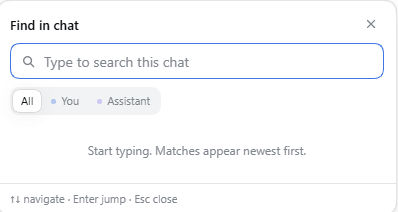

# Find in Chat (DeepSeek Harness plugin)

**English** | [Русский](#русский) | [中文](#中文)

A search control in the conversation header. It searches the **whole open session**, not just the part of the transcript Chat has already loaded, and lists every match from the newest to the oldest. Picking a result pages the history to that Turn, scrolls to the message, and marks the exact text.

## Features

- One magnifier button in the conversation header, next to the Session utilities.
- Literal, case-insensitive search; whitespace in the query matches any whitespace run, so `lu box` finds `lu\nbox`.
- Results are one row per occurrence, newest first, with the message kind, Turn, time, and a two-line preview around the match.
- A three-way selector — **All**, **You**, **Assistant** — chooses which author stays in the results; **All** is the default. The Host applies it before the 500-hit cap, so narrowing the author never hides the remaining matches.
- `↑` / `↓` move through the list, `Enter` opens the active match, a click opens any row.
- The Chat is asked to load the missing history window before the jump, so matches in old Turns work too.
- The matched text is highlighted with the CSS Custom Highlight API, and a short-lived ring marks the exact spot (it stays visible even inside inline code, where a highlight would sit under the code background).
- Closing with `Esc`, the close button, or a click outside. The panel follows the header when the window is resized.
- English, Russian, and Simplified Chinese copy, following the page language.
- No global keyboard shortcut: the control is the way in, so it never competes with the built-in Session search shortcut.

## What is searched

Only text the user can see as an ordinary Chat row:

- human `user/message` entries;
- the text blocks of `assistant/message` answers.

Reasoning, tool calls and tool outputs, injected context, system prompts, and compaction checkpoints are not searched. This keeps every result addressable in the Chat and avoids turning a short query into hundreds of tool-output fragments.

The Host reads the complete live log through `ctx.sessionQuery.readSession()` and asks `listEvents()` which records are still on the current surface, so replaced and shadowed messages are skipped while Turn and Step boundaries remain available. One parsed document list is cached per Session and rebuilt when the live log grows.

## Install

The plugin is a normal DeepSeek Harness bundle with a Host half and a browser half.

1. Put this directory into the profile's package tree, for example
   `~/.dsh/profiles/desktop/node_modules/@local/find-in-chat/`.
2. Add `"@local/find-in-chat": "1.0.0"` to the profile `package.json` `dependencies`.
3. Add `"@local/find-in-chat"` to `dsh.profile.bundles` in the same file.
4. Restart DSH. The bundle's `cordis.patch.yml` inserts the `find-in-chat` row; nothing else needs enabling.

With the plugin manager available, install this folder as a bundle instead of steps 1–3.

## How it works

| File | Role |
|---|---|
| `index.js` | Host plugin: registers `GET /find-in-chat/search` and `GET /find-in-chat/status`, projects the Session surface into searchable documents, and caches them. |
| `lib/search.js` | Pure extraction and match logic, shared by the Host route and the tests. |
| `client.js` | Browser plugin: the header control, the result panel, history loading, scroll, highlighting, and copy. |
| `cordis.patch.yml` | Inserts the bundle row. |
| `locale/*.json` | Plugin Manager title, description, and the icon metadata. |

The browser calls the Host route with the current Session id. The Host returns hits with their `seq`, Turn, and step. The browser asks the Session controller for `loadThrough(seq)`, finds the rendered row by its conversation key (`input-message` + message id, or `assistant-step` + `<turn>:<step>`), and falls back to a Turn and text lookup if the key shape changes.

## Limits

- Messages only, by design; see [What is searched](#what-is-searched).
- A search returns at most 500 occurrences and reports that the list was truncated.
- The history jump can take a moment when the match is far outside the loaded window; the panel shows “Opening message…” while it pages.
- The Host re-reads the Session surface when the log grows, so a very large Session makes each new keystroke spend more time on the Host.
- Matching is literal; regular expressions are not interpreted.

## Privacy

Everything stays local. The browser talks only to the DSH Host on the same origin, and the Host reads only the Sessions the DSH profile already owns. There is no telemetry, no external request, and no network dependency.

## License

MIT

---

## Русский

[English](#find-in-chat-deepseek-harness-plugin) | **Русский** | [中文](#中文)

Кнопка поиска в шапке чата. Ищет по **всей открытой сессии**, а не только по той части переписки, которая уже загружена в Chat, и показывает все совпадения от новых к старым. По нажатию на результат чат догружает нужный участок истории, прокручивается к сообщению и подсвечивает точное место.

### Возможности

- Кнопка с лупой в шапке чата, рядом с остальными действиями сессии.
- Поиск буквальный, без учёта регистра; пробелы в запросе совпадают с любым набором пробельных символов, поэтому `lu box` находит `lu\nbox`.
- Каждая строка списка — одно совпадение, сначала самые новые; видны тип сообщения, ход, время и две строки контекста вокруг найденного текста.
- Переключатель на три положения — **Все**, **Вы**, **Ассистент** — выбирает, чьи сообщения оставить в результатах; по умолчанию **Все**. Host применяет выбор до лимита в 500 совпадений, поэтому сужение автора не прячет оставшиеся совпадения.
- `↑` / `↓` листают список, `Enter` открывает выбранное совпадение, клик открывает любую строку.
- Перед переходом Chat догружает недостающую часть истории, поэтому работают и совпадения в старых ходах.
- Найденный текст подсвечивается через CSS Custom Highlight, а точное место на короткое время обводится рамкой — её видно даже внутри inline-кода, где обычная подсветка уходит под фон плашки.
- Закрытие по `Esc`, кнопке закрытия или клику вне панели. Панель следует за шапкой при изменении размера окна.
- Тексты на английском, русском и китайском в соответствии с языком страницы.
- Глобальной горячей клавиши нет: вход только через кнопку, поэтому плагин не спорит со встроенным поиском по сессиям.

### Что ищется

Только текст, который пользователь видит обычной строкой чата:

- сообщения пользователя (`user/message`);
- текстовые блоки ответов ассистента (`assistant/message`).

Рассуждения, вызовы и результаты инструментов, внедрённый контекст, системные промпты и точки компакции не ищутся. Так каждый результат можно показать в чате, а короткий запрос не превращается в сотни фрагментов вывода инструментов.

Host читает полный живой журнал через `ctx.sessionQuery.readSession()` и запрашивает у `listEvents()`, какие записи ещё находятся на текущей поверхности. Поэтому заменённые и скрытые сообщения пропускаются, а границы ходов и шагов остаются доступны. Разобранный список документов кэшируется на сессию и перестраивается, когда журнал растёт.

### Установка

Плагин — обычный бандл DeepSeek Harness с Host- и браузерной половинами.

1. Положите эту папку в дерево пакетов профиля, например
   `~/.dsh/profiles/desktop/node_modules/@local/find-in-chat/`.
2. Добавьте `"@local/find-in-chat": "1.0.0"` в `dependencies` файла `package.json` профиля.
3. Добавьте `"@local/find-in-chat"` в `dsh.profile.bundles` там же.
4. Перезапустите DSH. `cordis.patch.yml` бандла вставит строку `find-in-chat`; больше ничего включать не нужно.

Если доступен plugin manager, установите эту папку как бандл вместо шагов 1–3.

### Как устроено

| Файл | Назначение |
|---|---|
| `index.js` | Host-плагин: маршруты `GET /find-in-chat/search` и `GET /find-in-chat/status`, разбор поверхности сессии и кэш. |
| `lib/search.js` | Чистая логика извлечения текста и поиска; используется маршрутом и тестами. |
| `client.js` | Браузерный плагин: кнопка, панель, догрузка истории, прокрутка, подсветка, тексты. |
| `cordis.patch.yml` | Вставляет строку бандла. |
| `locale/*.json` | Название и описание в Plugin Manager, метаданные иконки. |

Браузер передаёт Host-маршруту id текущей сессии. Host возвращает совпадения с `seq`, номером хода и шага. Браузер просит Session controller выполнить `loadThrough(seq)`, находит отрисованную строку по ключу разговора (`input-message` + id сообщения либо `assistant-step` + `<ход>:<шаг>`) и откатывается к поиску по ходу и тексту, если формат ключа изменится.

### Ограничения

- Только сообщения, по замыслу; см. раздел «Что ищется».
- Поиск возвращает не больше 500 совпадений и сообщает, что список обрезан.
- Догрузка истории может занять мгновение, если совпадение далеко за пределами загруженного окна; панель показывает «Открываю сообщение…».
- Host перечитывает поверхность сессии при росте журнала, поэтому в очень большой сессии каждое новое нажатие клавиши тратит больше времени на Host.
- Совпадения буквальные; регулярные выражения не поддерживаются.

### Приватность

Всё остаётся локально. Браузер обращается только к DSH Host на том же origin, а Host читает только те сессии, которыми уже владеет профиль DSH. Никакой телеметрии, внешних запросов и сетевых зависимостей.

### Лицензия

MIT

---

## 中文

[English](#find-in-chat-deepseek-harness-plugin) | [Русский](#русский) | **中文**

聊天标题栏中的搜索按钮。它搜索**整个打开的会话**，而不只是 Chat 已经加载的那一段，并按从新到旧列出所有匹配项。点击结果后，Chat 会加载缺失的历史、滚动到该消息并标出准确位置。

### 功能

- 会话标题栏中的一个放大镜按钮，位于会话操作区。
- 字面匹配、不区分大小写；查询中的空白可匹配任意空白，因此 `lu box` 能找到 `lu\nbox`。
- 列表每一行是一个匹配项，最新的在前，显示消息类型、轮次、时间和匹配处周围的两行预览。
- 三档选择器 **全部 / 你 / 助手**，决定结果中保留谁的消息；默认 **全部**。Host 在 500 条上限之前应用筛选，因此缩小作者范围不会隐藏其余匹配。
- `↑` / `↓` 在列表中移动，`Enter` 打开当前匹配项，点击任意行也可以打开。
- 跳转前会让 Chat 加载缺失的历史窗口，因此旧轮次中的匹配也能打开。
- 匹配文本用 CSS Custom Highlight 标出，并用一个短暂的圆角框圈出准确位置——即使匹配位于行内代码中，高亮会被代码底色盖住，圆角框仍然可见。
- 支持 `Esc`、关闭按钮和点击面板外关闭。窗口尺寸变化时面板跟随标题栏。
- 提供英文、俄文和简体中文文案，跟随页面语言。
- 不注册全局快捷键：入口只有按钮，因此不会和内置的会话搜索快捷键冲突。

### 搜索范围

只搜索用户能在 Chat 中看到的普通消息：

- 用户的 `user/message` 消息；
- 助手回答中的文本块（`assistant/message`）。

推理内容、工具调用与工具输出、注入的上下文、系统提示和压缩检查点不参与搜索。这样每个结果都能在 Chat 中定位，短查询也不会变成数百条工具输出片段。

Host 通过 `ctx.sessionQuery.readSession()` 读取完整的实时日志，并用 `listEvents()` 确认哪些记录仍在当前表面上。因此被替换或隐藏的消息会被跳过，同时保留轮次和步骤边界。每个会话缓存一份解析后的文档列表，日志增长时重建。

### 安装

插件是普通的 DeepSeek Harness bundle，包含 Host 和浏览器两部分。

1. 把本目录放到配置文件的包目录中，例如
   `~/.dsh/profiles/desktop/node_modules/@local/find-in-chat/`。
2. 在配置文件的 `package.json` 的 `dependencies` 中加入 `"@local/find-in-chat": "1.0.0"`。
3. 在同一个文件的 `dsh.profile.bundles` 中加入 `"@local/find-in-chat"`。
4. 重启 DSH。bundle 的 `cordis.patch.yml` 会插入 `find-in-chat` 行，不需要再启用其他内容。

如果可以使用 plugin manager，请直接把该目录作为 bundle 安装，跳过第 1–3 步。

### 实现

| 文件 | 作用 |
|---|---|
| `index.js` | Host 插件：注册 `GET /find-in-chat/search` 和 `GET /find-in-chat/status`，把会话表面投影为可搜索文档并缓存。 |
| `lib/search.js` | 纯文本提取与匹配逻辑，供 Host 路由和测试共用。 |
| `client.js` | 浏览器插件：标题栏按钮、结果面板、历史加载、滚动、高亮和文案。 |
| `cordis.patch.yml` | 插入 bundle 行。 |
| `locale/*.json` | Plugin Manager 中的标题、描述和图标元数据。 |

浏览器把当前会话 id 传给 Host 路由。Host 返回带有 `seq`、轮次和步骤的匹配项。浏览器通过 Session controller 调用 `loadThrough(seq)`，按对话键（`input-message` + 消息 id，或 `assistant-step` + `<轮次>:<步骤>`）找到已渲染的行；如果键格式变化，则回退到按轮次和文本查找。

### 限制

- 按设计只搜索消息；见“搜索范围”。
- 单次最多返回 500 个匹配项，并会提示列表被截断。
- 当匹配项远在已加载窗口之外时，加载历史可能需要一点时间；面板会显示“正在打开消息…”。
- 日志增长时 Host 会重新读取会话表面，因此超大会话中每次按键在 Host 上的耗时都会增加。
- 匹配是字面匹配，不支持正则表达式。

### 隐私

所有内容都留在本地。浏览器只访问同源的 DSH Host，Host 只读取 DSH 配置文件已经拥有的会话。没有遥测、外部请求或网络依赖。

### 许可证

MIT
